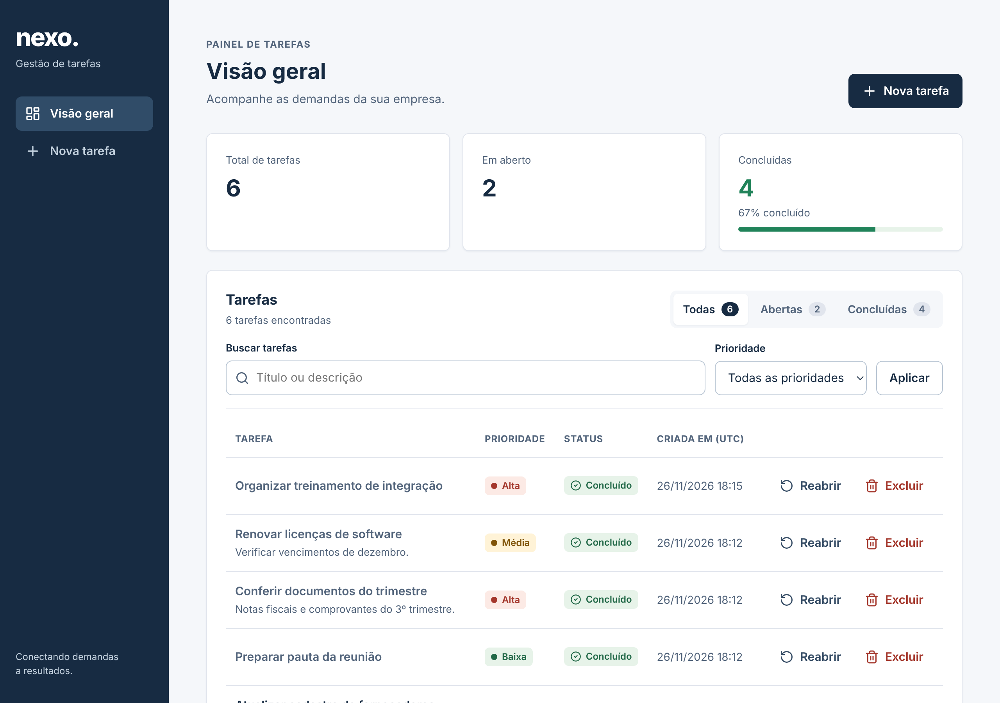
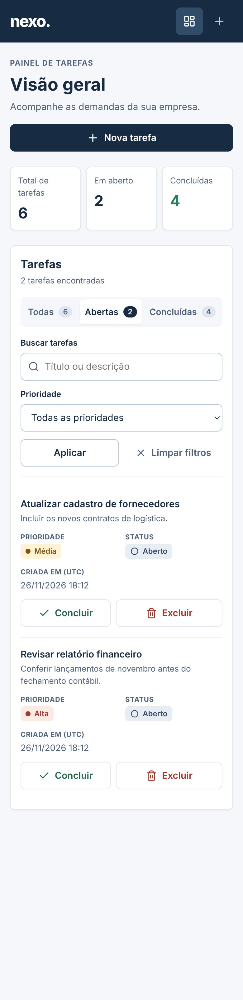
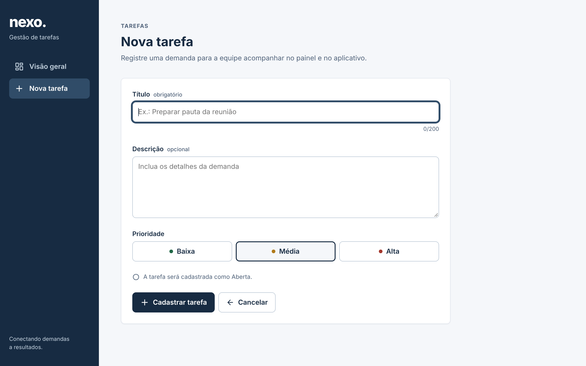
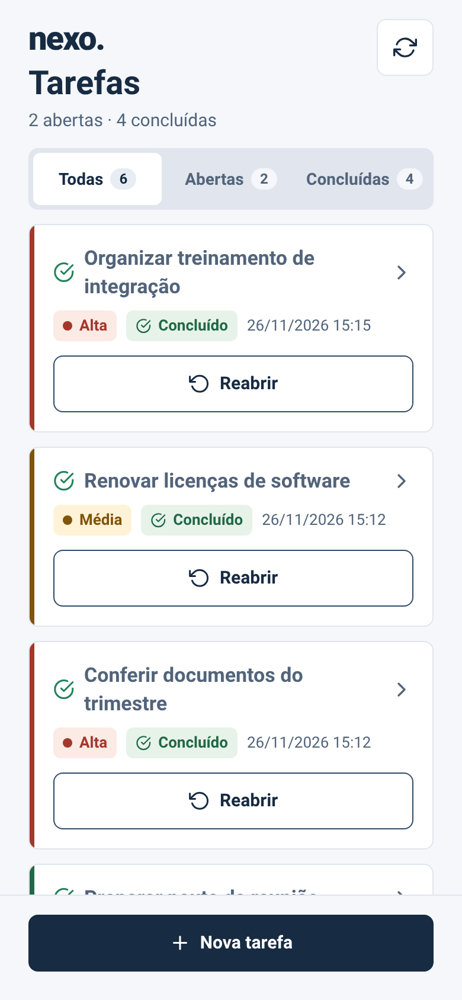

# nexo. — Sistema Integrado de Chamados

Aplicação de gestão de chamados/tarefas composta por um **painel Web + API REST em PHP** e um **aplicativo mobile em React Native (Expo)** que consome essa API. Os três componentes usam o mesmo banco SQLite.



| Painel no celular | Nova tarefa (Web) | Aplicativo |
|---|---|---|
|  |  |  |

## Tecnologias

- **Back-end e Web:** PHP 8.2 puro, PDO com SQLite e prepared statements; páginas renderizadas no servidor, CSS puro, sem framework e sem build.
- **Mobile:** React Native 0.88 com Expo 58 e TypeScript; `@expo/vector-icons` para ícones.
- **Testes:** Python 3 (testes HTTP), PHP (renderização e repositório) e `node:test` (app).

## Estrutura de dados

Tabela `chamados` ([`web-php/database/schema.sql`](web-php/database/schema.sql)), com as regras garantidas também por constraints no banco:

| Coluna | Tipo | Regra |
|---|---|---|
| `id` | INTEGER | chave primária, auto incremento |
| `titulo` | TEXT | obrigatório, 1 a 200 caracteres, não pode ser só espaços |
| `descricao` | TEXT | opcional, até 5000 caracteres |
| `prioridade` | TEXT | `Baixa`, `Media` ou `Alta` (padrão `Media`) |
| `status` | TEXT | `Aberto` ou `Concluido` (padrão `Aberto`) |
| `criado_em` | TEXT | data/hora de criação em UTC (ISO 8601) |

A API usa os valores canônicos acima; a interface exibe "Média" e "Concluído" com acento.

## Requisitos atendidos

### API REST (JSON)

| Método | Rota | Função |
|---|---|---|
| `GET` | `/api/chamados` | Lista todos os chamados (opcional: `?status=Aberto` ou `?status=Concluido`) |
| `POST` | `/api/chamados` | Cadastra um chamado; valida se o título foi preenchido |
| `PATCH` | `/api/chamados/{id}` | Atualiza o status (`{"status": "Concluido"}`) |
| `DELETE` | `/api/chamados/{id}` | Exclui um chamado |

Respostas `{"data": ...}`; erros `{"error": {"message": "...", "fields": {...}}}` com códigos 400, 404, 405, 415, 422 e 500 sem expor detalhes internos. Cabeçalhos `Content-Type: application/json` e CORS configurável (com preflight `OPTIONS`). Contrato completo e exemplos em [`docs/api.md`](docs/api.md).

### Painel Web

- Lista todos os chamados do banco, com indicadores (total, em aberto, concluídas e percentual).
- **Filtro por status** Todos / Abertos / Concluídos, em abas com a contagem de cada um.
- **Excluir com confirmação** em página própria, com token CSRF e redirecionamento após o POST.
- Layout limpo em CSS puro, responsivo (abaixo de 760 px a tabela vira lista de cartões) e acessível por teclado.

Extras além do pedido: busca por título ou descrição, filtro por prioridade, cadastro de chamado pela Web, concluir/reabrir pelo painel. Os filtros ativos são preservados após cada ação. O painel funciona com JavaScript desligado.

| Rota | Função |
|---|---|
| `GET /` | Painel com indicadores, abas, busca (`q`) e prioridade (`prioridade`) |
| `GET/POST /nova` | Cadastro de chamado pela Web |
| `POST /status` | Concluir ou reabrir |
| `GET/POST /excluir` | Confirmação e exclusão |

### Aplicativo Mobile

- **Listagem** com título, prioridade e status, consumindo a API.
- **Atualizar a lista** com pull-to-refresh ou pelo botão de atualizar.
- **Concluir/reabrir** cada chamado, enviando a atualização para a API.
- **Cadastro** de chamado (título, descrição e prioridade) em tela própria.
- **Carregamento e erros:** indicador de carregamento durante as requisições e mensagem amigável quando a API não responde, com "Tentar novamente" e a lista anterior preservada.

Extras: filtro por status, tela de detalhes do chamado, proteção contra toque duplicado e nenhuma mensagem de sucesso antes da confirmação da API.

## Como rodar

### Requisitos

- PHP 8.2+ com as extensões `pdo` e `pdo_sqlite` (`php -r 'print_r(PDO::getAvailableDrivers());'` deve listar `sqlite`).
- Node 24.3+ e npm.
- Expo Go no celular, ou um emulador Android/iOS.

### 1. Banco de dados e servidor PHP

Na raiz do repositório:

```bash
php web-php/database/init.php
```

```bash
php -S 127.0.0.1:8000 -t web-php/public web-php/public/router.php
```

O primeiro comando cria o banco a partir de [`web-php/database/schema.sql`](web-php/database/schema.sql) em `web-php/database/nexo.sqlite` (fora da pasta pública e ignorado pelo Git); pode ser executado mais de uma vez. O painel fica em [localhost:8000](http://localhost:8000) e a API em [localhost:8000/api/chamados](http://localhost:8000/api/chamados).

Opcional, por variáveis de ambiente (veja [`web-php/.env.example`](web-php/.env.example)): `NEXO_DB_PATH` escolhe outro arquivo de banco (use o mesmo valor nos dois comandos) e `NEXO_CORS_ORIGINS` define as origens liberadas no CORS.

### 2. Onde alterar o IP/URL da API no app

O endereço da API fica na variável `EXPO_PUBLIC_API_URL`, no arquivo `app-mobile/.env` (copiado de [`app-mobile/.env.example`](app-mobile/.env.example)). Ela deve terminar em `/api`:

| Onde o app roda | Valor |
|---|---|
| Expo Web ou simulador iOS na mesma máquina | `http://localhost:8000/api` |
| Emulador Android | `http://10.0.2.2:8000/api` |
| Celular físico (Expo Go) | `http://IP_DO_COMPUTADOR:8000/api` |

Para o celular físico, computador e celular precisam estar na mesma rede Wi-Fi e o PHP deve escutar em todas as interfaces:

```bash
php -S 0.0.0.0:8000 -t web-php/public web-php/public/router.php
```

Libere a porta 8000 no firewall apenas para a rede local. Reinicie o Expo depois de alterar o `.env`.

### 3. Projeto Expo

```bash
cd app-mobile
npm ci
cp .env.example .env
npm start
```

Leia o QR code com o Expo Go, ou pressione `a` (Android), `i` (iOS) ou `w` (navegador).

> A API não tem autenticação e o servidor embutido do PHP é para desenvolvimento: não exponha este servidor na internet.

## Testes

Com as dependências do app instaladas (`npm ci` em `app-mobile/`), na raiz:

```bash
python3 scripts/verify.py
```

O script verifica a sintaxe de todo o PHP e roda os testes HTTP da API e do painel, os testes de renderização e do repositório, um fluxo integrado (o cliente real do app cria e conclui, o painel filtra e exclui, o app atualiza), os testes do app e o TypeScript. Os servidores de teste usam bancos temporários e escutam só em `127.0.0.1`. Com `--exports`, também gera os bundles Web, Android e iOS do Expo.

Sem PHP instalado no Linux, `sh scripts/setup-local-php.sh` baixa um PHP 8.2 local em `.tools/php82/`; nesse caso rode `PHP_BIN="$PWD/.tools/php82/php" python3 scripts/verify.py`.

## Organização

```text
web-php/
  public/     entrada HTTP (index.php, router.php) e assets
  src/        repositório PDO, validação e erros
  pages/      controlador do painel e funções auxiliares (CSRF, filtros)
  views/      layout, telas e ícones SVG
  config/     configuração por variáveis de ambiente
  database/   schema.sql e inicializador
  tests/      testes HTTP, de renderização e do repositório
app-mobile/
  App.tsx     navegação entre lista, detalhes e cadastro
  src/        cliente HTTP (api.ts), estado (store.ts), telas e componentes
  tests/      testes do cliente, do estado e da formatação
scripts/      verificação completa e teste integrado
docs/         contrato da API, design system e capturas
```

## Decisões técnicas

- **PHP sem framework:** o escopo é pequeno; um front controller com rotas explícitas mantém tudo legível e sem dependências.
- **SQLite com constraints:** título obrigatório, enums e limites ficam no banco além da validação em PHP, e a instalação não exige servidor de banco.
- **Uma regra de negócio só:** API e painel usam o mesmo `TaskRepository`, então as validações não se duplicam.
- **Segurança:** prepared statements em todas as consultas, escape de todo HTML, CSRF nas escritas do painel, busca com curingas do `LIKE` escapados e banco fora da pasta pública.
- **App sem biblioteca de navegação:** três telas são controladas por estado; o estado fica num store testável, separado da interface.

Fora do escopo desta versão: autenticação, usuários e notificações. Datas: o painel mostra UTC (indicado na coluna) e o app mostra o horário do aparelho.

Ícones: Web com SVG do [Lucide](https://lucide.dev) (licença ISC); app com `@expo/vector-icons` (Feather).
